# plot-ascii

Cartesian plan plotted with ASCII.

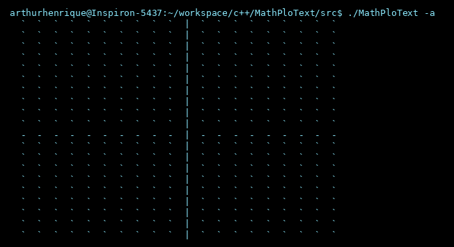

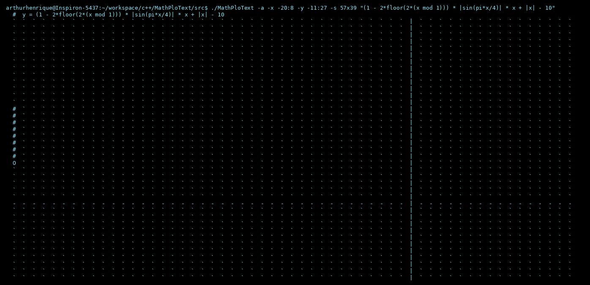

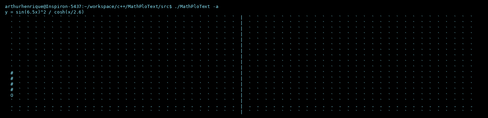

## Run

```sh
cd src && make
./MathPloText        # x^2, Matharium and SinCosh
./MathPloText -a     # animated
```

Any function of x:

```sh
./MathPloText "x^2"
./MathPloText -x -6.3:6.3 "sin(x)" "D(sin(x))" "I(sin(x))"
./MathPloText -a -x -4:4 "sin(6.5x)^2 / cosh(x/2.6)"
```

| option | |
|---|---|
| `-a` | animate |
| `-x MIN:MAX` | x range (default `-10:10`) |
| `-y MIN:MAX` | y range (default fits the curve) |
| `-s WIDTHxHEIGHT` | size (default `57x30`) |

Functions: `+ - * / ^ mod |x| pi e sin cos tan sinh cosh tanh exp ln log sqrt floor ceil round`,
`D(f)` derivative, `I(f)` integral, and every function [below](#functions).

## Functions

Built in as `name(x)` in the CLI and `Name(x)` in `MathPloTextFunction.hpp`, except the last five, which are plain expressions.

### Blancmange

triangle waves stacked into a fractal: `sum of triangle(2^n x) / 2^n`

```sh
./MathPloText -a -x 0:2 -y 0:0.72 -s 57x18 "blancmange(x)"
```

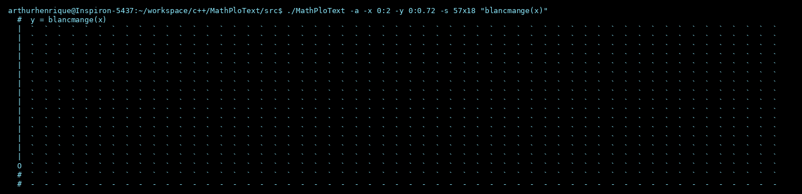

### Exponential sawtooth

a sawtooth of decaying exponentials: `e^(-3 (x mod 1))`

```sh
./MathPloText -a -x 0:5 -y 0:1.05 -s 57x16 "expsaw(x)"
```

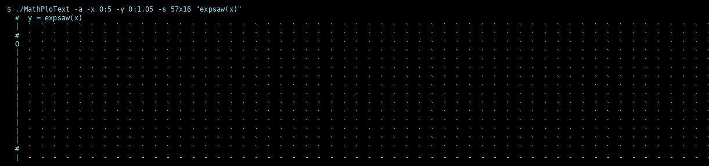

### Exponential fan

mod 1 slicing an exponential into a fan of lines: `e^x mod 1`

```sh
./MathPloText -a -x 0:2.6 -y 0:1.05 -s 57x18 "expmod(x)"
```

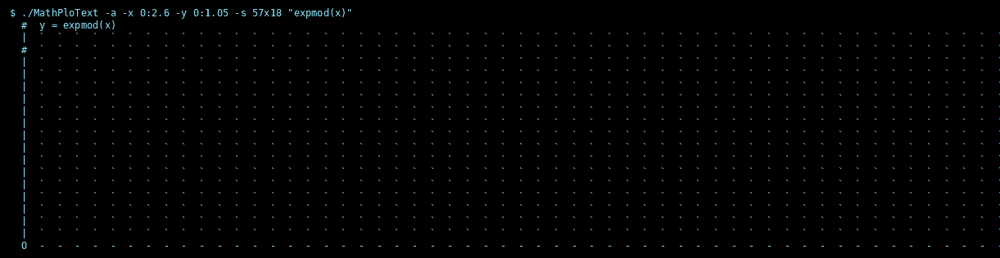

### Weierstrass

continuous everywhere, smooth nowhere: `sum of 0.5^n cos(3^n pi x)`

```sh
./MathPloText -a -x -2:2 -y -2.1:2.1 -s 57x22 "weierstrass(x)"
```

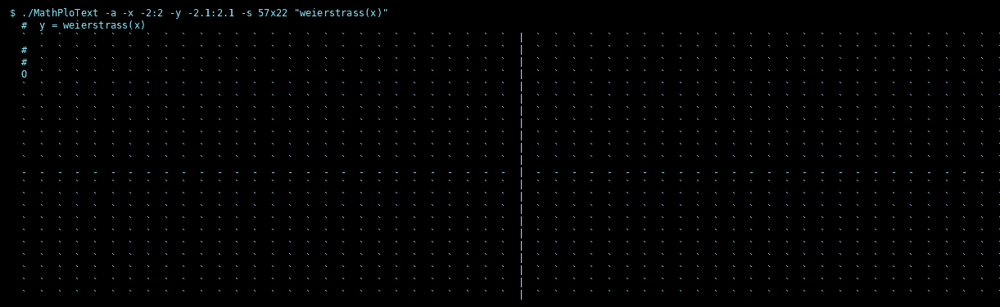

### Riemann

`sum of sin(n^2 x) / n^2`

```sh
./MathPloText -a -x -6.3:6.3 -y -1.1:1.7 -s 57x20 "riemann(x)"
```

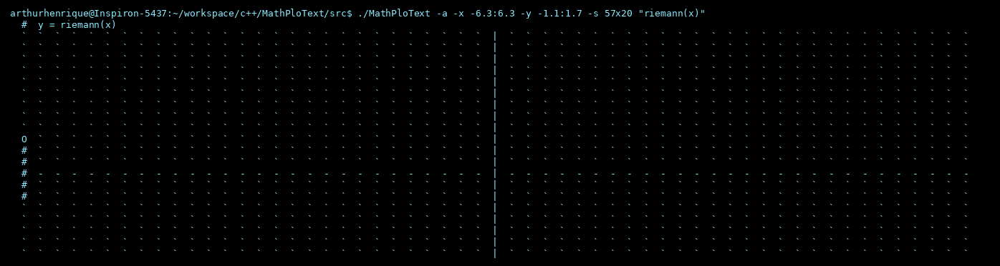

### Cantor, the devil's staircase

flat almost everywhere, still climbs from 0 to 1

```sh
./MathPloText -a -x 0:1 -y 0:1.05 -s 57x20 "cantor(x)"
```

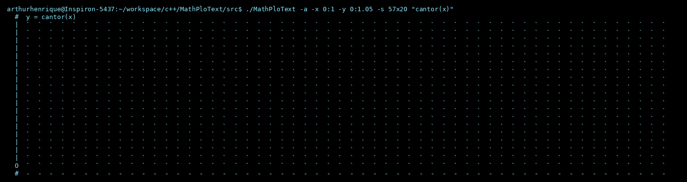

### Heart

`x^(2/3) + 0.9 sqrt(3.3 - x^2) sin(10 pi x)`

```sh
./MathPloText -a -x -1.85:1.85 -y -1.5:2.6 -s 37x30 "heart(x)"
```

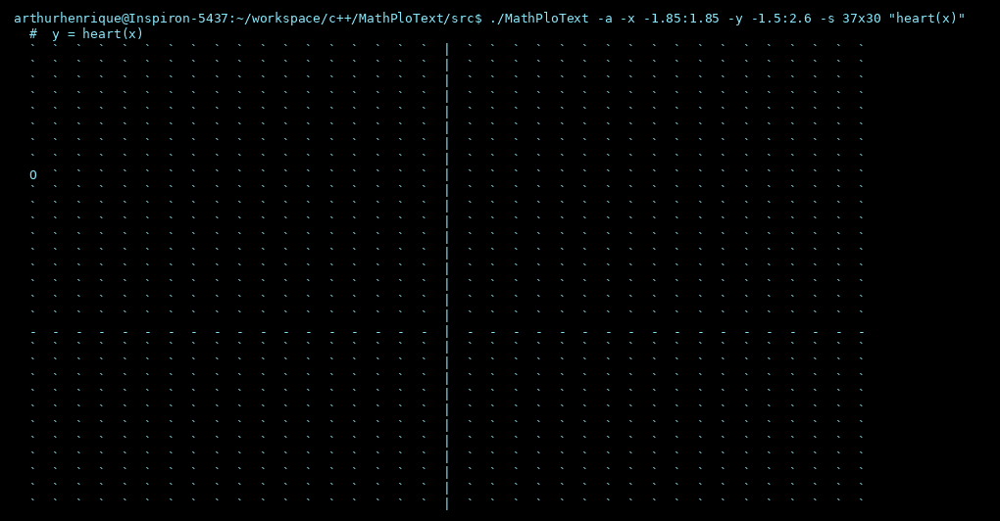

### Square wave

its first 8 Fourier terms: `4/pi sum of sin((2k-1) x) / (2k-1)`

```sh
./MathPloText -a -x -6.3:6.3 -y -1.4:1.4 -s 57x16 "square(x)"
```

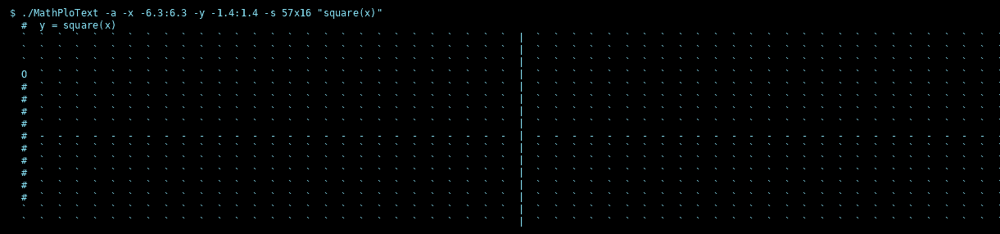

### Sinc

`sin(x) / x`

```sh
./MathPloText -a -x -20:20 -y -0.3:1.05 -s 57x16 "sinc(x)"
```

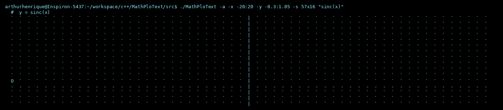

### Bessel J0

a drum head

```sh
./MathPloText -a -x -20:20 -y -0.45:1.05 -s 57x16 "bessel(x)"
```

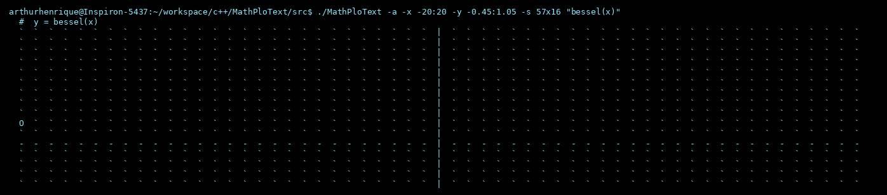

### Gamma

the factorial for any x: `gamma(n) = (n-1)!`

```sh
./MathPloText -a -x -4.5:4.5 -y -6:6 -s 57x22 "gamma(x)"
```

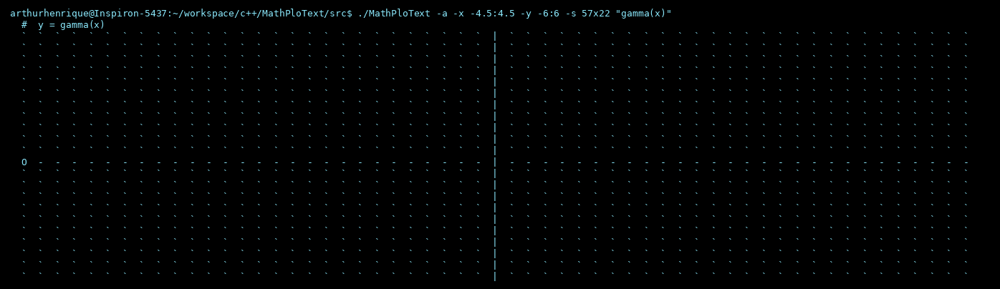

### Chirp

`sin(x^2)`

```sh
./MathPloText -a -x 0:6 -y -1.1:1.1 -s 57x14 "sin(x^2)"
```

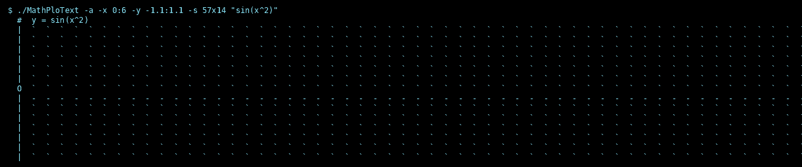

### x sin(1/x)

squeezed to zero

```sh
./MathPloText -a -x -0.6:0.6 -y -0.15:0.6 -s 57x18 "x sin(1/x)"
```

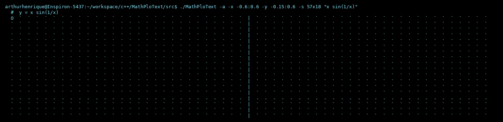

### Beats

`sin(6x) sin(x/2)`

```sh
./MathPloText -a -x -6.3:6.3 -y -1.1:1.1 -s 57x16 "sin(6x) sin(x/2)"
```

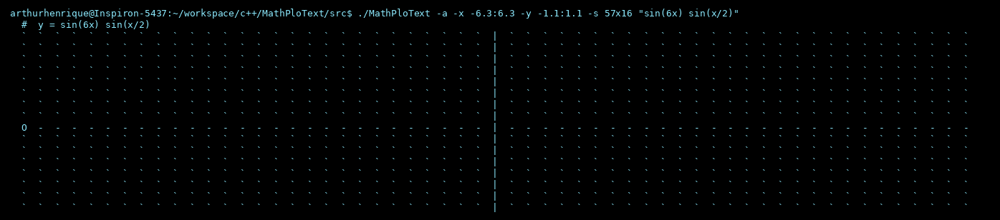

### Damped oscillation

`e^(-x/4) sin(4x)`

```sh
./MathPloText -a -x 0:12 -y -1:1 -s 57x18 "e^(-x/4) sin(4x)"
```

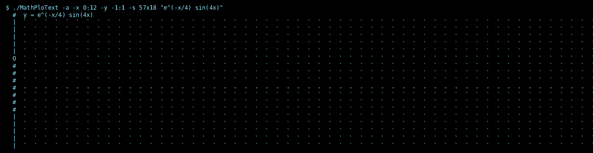

### sin(e^-x)

`sin(e^(-x))` riding on `e^(-x)` until both fade into the axis

```sh
./MathPloText -a -x -1.8:6.3 -y -1.2:6 -s 57x22 "sin(e^(-x))" "e^(-x)"
```

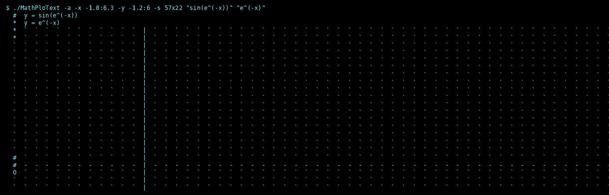
## C++

```cpp
MathPloText *math = new MathPloText();

math->SetConfig();
math->SetMatrix();
math->AnimateGraph(Pow, 2);

math->AddCurve(Matharium);
math->SetWindow(-20, 8, -11, 27);
math->AnimateCurves();
```
