# plot-ascii

Cartesian plan plotted with ASCII.


## Run

```sh
make
./MathPloText        # x^2
./MathPloText -a     # animated
```

Every function of the [gallery](#functions) has its own target:

```sh
make list            # every function, by category
make burgers         # Burgers' shock
make heart
```

Any function of x:

```sh
./MathPloText "x^2"
./MathPloText -x -6.3:6.3 "sin(x)" "D(sin(x))" "I(sin(x))"
./MathPloText -a -x -4:4 "sin(6.5x)^2 / cosh(x/2.6)"
./MathPloText -t 3 -x -3.2:3.2 "burgers(x, t)"
```

| option | |
|---|---|
| `-a` | animate, drawing x from left to right |
| `-t MAX` | animate time `t` from 0 to `MAX` |
| `-d MS` | milliseconds between frames |
| `-x MIN:MAX` | x range (default `-10:10`) |
| `-y MIN:MAX` | y range (default fits the curve) |
| `-s WIDTHxHEIGHT` | size (default `57x30`) |

Write with `x`, `t`, numbers, `pi`, `e`, `+ - * / ^ mod`, `|x|`, `sin cos tan sinh cosh tanh exp ln log sqrt floor ceil round`,
`D(f)` derivative, `I(f)` integral, and every function [below](#functions).

## Functions

Call any of them by name, like `heart(x)` or `burgers(x, t)`, and mix them in expressions.
The gallery is made by `tools/gallery.py` from the list in `tools/gallery.txt`.

<!-- gallery -->

### Navier-Stokes and fluids

Exact solutions of the Navier-Stokes equations, animated in time with `-t`. Whether a smooth 3D flow can blow up is a Millennium Prize problem: OpenAI announced a proof of blow-up in September 2026, and the Clay Institute still lists it as open.

<table>
<tr>
<td width="50%" valign="top">
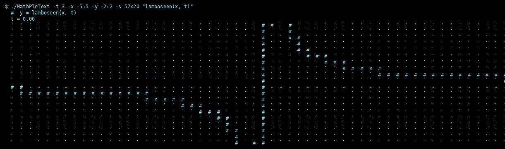<br>
<b>Lamb-Oseen vortex</b>: a whirlpool spreading out as viscosity eats it<br>
<sub><code>./MathPloText -t 3 -x -5:5 -y -2:2 -s 57x20 "lamboseen(x, t)"</code></sub>
</td>
<td width="50%" valign="top">
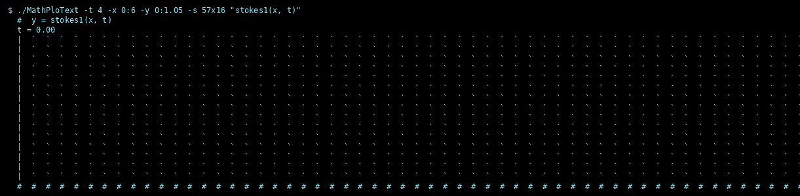<br>
<b>Stokes' first problem</b>: a plate starts moving under the fluid, and the fluid above follows<br>
<sub><code>./MathPloText -t 4 -x 0:6 -y 0:1.05 -s 57x16 "stokes1(x, t)"</code></sub>
</td>
</tr>
<tr>
<td width="50%" valign="top">
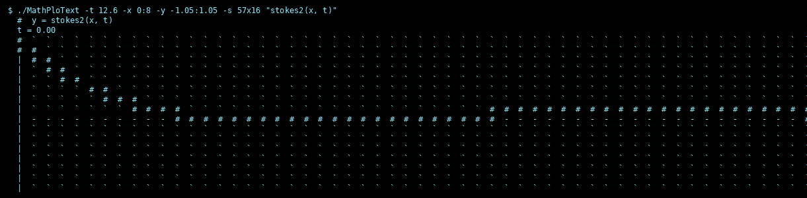<br>
<b>Stokes' second problem</b>: a plate going back and forth; the motion fades with height<br>
<sub><code>./MathPloText -t 12.6 -x 0:8 -y -1.05:1.05 -s 57x16 "stokes2(x, t)"</code></sub>
</td>
<td width="50%" valign="top">
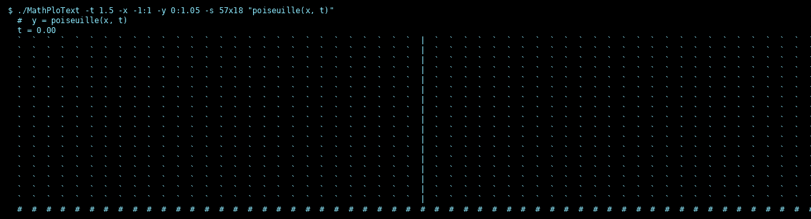<br>
<b>Channel flow starting up</b>: pushed from rest until it becomes the Poiseuille parabola<br>
<sub><code>./MathPloText -t 1.5 -x -1:1 -y 0:1.05 -s 57x18 "poiseuille(x, t)"</code></sub>
</td>
</tr>
<tr>
<td width="50%" valign="top">
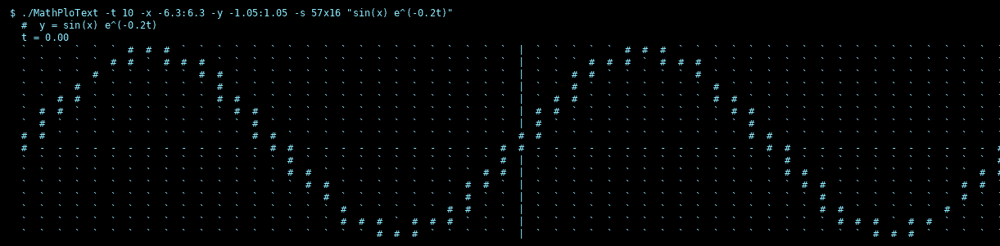<br>
<b>Taylor-Green vortex</b>: a row of vortices fading together<br>
<sub><code>./MathPloText -t 10 -x -6.3:6.3 -y -1.05:1.05 -s 57x16 "sin(x) e^(-0.2t)"</code></sub>
</td>
<td width="50%" valign="top">
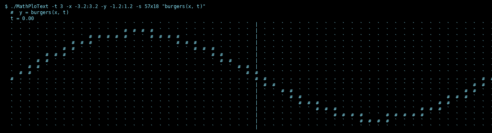<br>
<b>Burgers, a shock</b>: the 1D Navier-Stokes: a sine wave steepens into a shock at t = 1<br>
<sub><code>./MathPloText -t 3 -x -3.2:3.2 -y -1.2:1.2 -s 57x18 "burgers(x, t)"</code></sub>
</td>
</tr>
</table>

### Waves in time

Equations of physics, animated in time with `-t`.

<table>
<tr>
<td width="50%" valign="top">
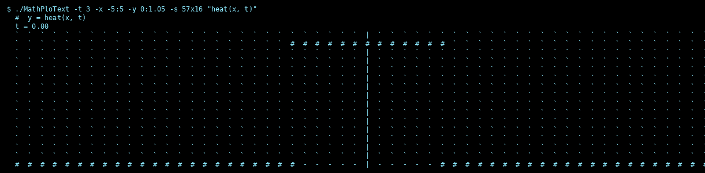<br>
<b>Heat equation</b>: a block of heat spreading out<br>
<sub><code>./MathPloText -t 3 -x -5:5 -y 0:1.05 -s 57x16 "heat(x, t)"</code></sub>
</td>
<td width="50%" valign="top">
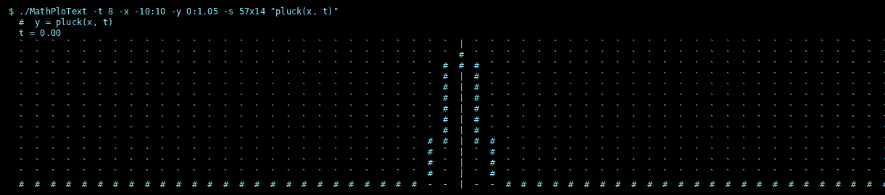<br>
<b>Wave equation</b>: a plucked bump splits into two<br>
<sub><code>./MathPloText -t 8 -x -10:10 -y 0:1.05 -s 57x14 "pluck(x, t)"</code></sub>
</td>
</tr>
<tr>
<td width="50%" valign="top">
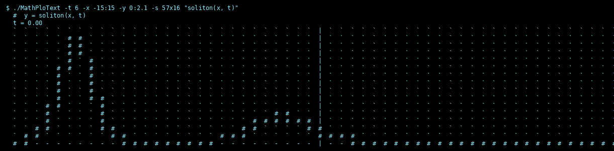<br>
<b>KdV solitons</b>: the tall fast wave passes through the small one and both come out the same<br>
<sub><code>./MathPloText -t 6 -x -15:15 -y 0:2.1 -s 57x16 "soliton(x, t)"</code></sub>
</td>
<td width="50%" valign="top">
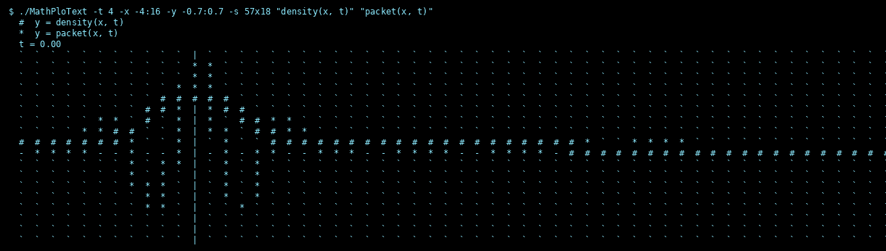<br>
<b>Schrodinger wave packet</b>: a free electron: its wave and where it can be<br>
<sub><code>./MathPloText -t 4 -x -4:16 -y -0.7:0.7 -s 57x18 "density(x, t)" "packet(x, t)"</code></sub>
</td>
</tr>
<tr>
<td width="50%" valign="top">
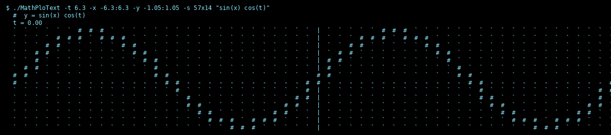<br>
<b>Standing wave</b>: <code>sin(x) cos(t)</code><br>
<sub><code>./MathPloText -t 6.3 -x -6.3:6.3 -y -1.05:1.05 -s 57x14 "sin(x) cos(t)"</code></sub>
</td>
<td width="50%" valign="top">
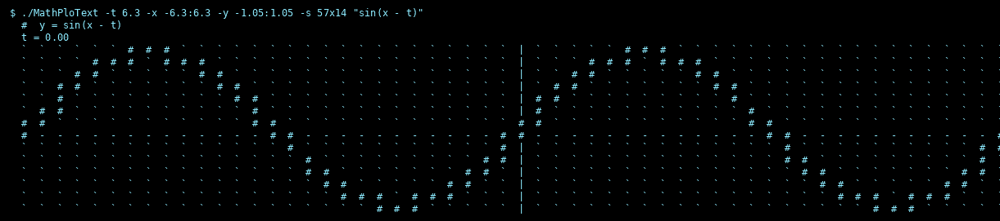<br>
<b>Travelling wave</b>: <code>sin(x - t)</code><br>
<sub><code>./MathPloText -t 6.3 -x -6.3:6.3 -y -1.05:1.05 -s 57x14 "sin(x - t)"</code></sub>
</td>
</tr>
<tr>
<td width="50%" valign="top">
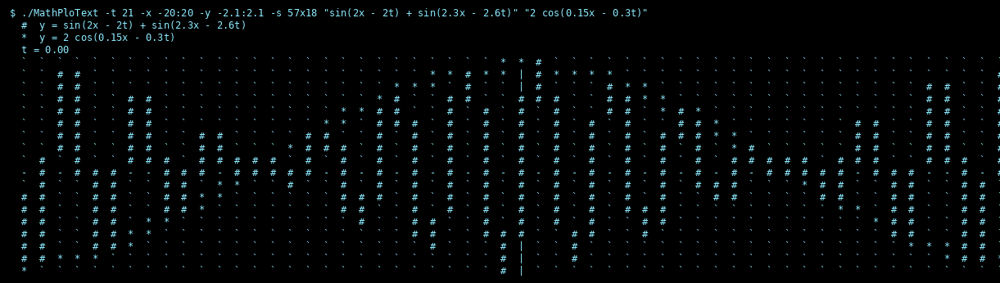<br>
<b>Group velocity</b>: two close waves: the beat moves at twice the speed of the ripples<br>
<sub><code>./MathPloText -t 21 -x -20:20 -y -2.1:2.1 -s 57x18 "sin(2x - 2t) + sin(2.3x - 2.6t)" "2 cos(0.15x - 0.3t)"</code></sub>
</td>
<td width="50%" valign="top">
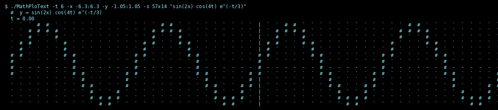<br>
<b>Damped standing wave</b>: <code>sin(2x) cos(4t) e^(-t/3)</code><br>
<sub><code>./MathPloText -t 6 -x -6.3:6.3 -y -1.05:1.05 -s 57x14 "sin(2x) cos(4t) e^(-t/3)"</code></sub>
</td>
</tr>
<tr>
<td width="50%" valign="top">
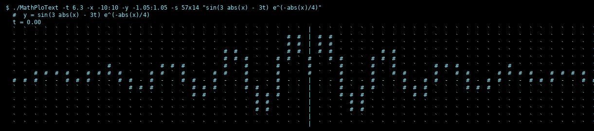<br>
<b>Ripple</b>: a stone dropped in water<br>
<sub><code>./MathPloText -t 6.3 -x -10:10 -y -1.05:1.05 -s 57x14 "sin(3 abs(x) - 3t) e^(-abs(x)/4)"</code></sub>
</td>
</tr>
</table>

### From the reels

Curves from matharium's videos, drawn with `-a`.

<table>
<tr>
<td width="50%" valign="top">
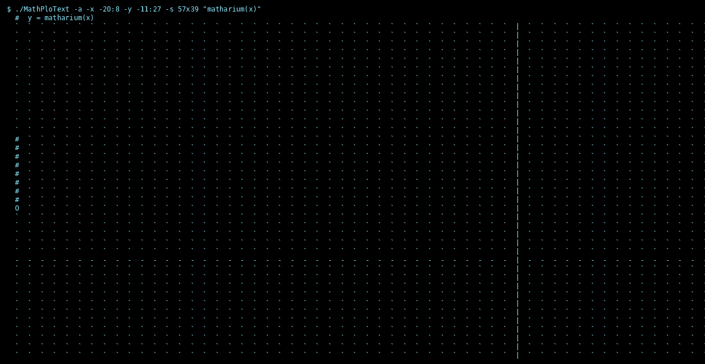<br>
<b>Matharium</b>: <code>(1 - 2 floor(2 (x mod 1))) abs(sin(pi x/4)) x + abs(x) - 10</code><br>
<sub><code>./MathPloText -a -x -20:8 -y -11:27 -s 57x39 "matharium(x)"</code></sub>
</td>
<td width="50%" valign="top">
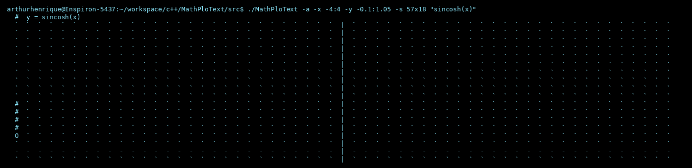<br>
<b>SinCosh</b>: <code>sin(6.5x)^2 / cosh(x/2.6)</code><br>
<sub><code>./MathPloText -a -x -4:4 -y -0.1:1.05 -s 57x18 "sincosh(x)"</code></sub>
</td>
</tr>
<tr>
<td width="50%" valign="top">
<br>
<b>sin(e^-x)</b>: <code>sin(e^(-x))</code> riding on <code>e^(-x)</code><br>
<sub><code>./MathPloText -a -x -1.8:6.3 -y -1.2:6 -s 57x22 "sin(e^(-x))" "e^(-x)"</code></sub>
</td>
<td width="50%" valign="top">
<br>
<b>Blancmange</b>: triangle waves stacked into a fractal<br>
<sub><code>./MathPloText -a -x 0:2 -y 0:0.72 -s 57x18 "blancmange(x)"</code></sub>
</td>
</tr>
<tr>
<td width="50%" valign="top">
<br>
<b>Exponential sawtooth</b>: a sawtooth of decaying exponentials, <code>e^(-3 (x mod 1))</code><br>
<sub><code>./MathPloText -a -x 0:5 -y 0:1.05 -s 57x16 "expsaw(x)"</code></sub>
</td>
<td width="50%" valign="top">
<br>
<b>Exponential fan</b>: mod 1 slicing an exponential into a fan of lines, <code>e^x mod 1</code><br>
<sub><code>./MathPloText -a -x 0:2.6 -y 0:1.05 -s 57x18 "expmod(x)"</code></sub>
</td>
</tr>
</table>

### Classic curves

<table>
<tr>
<td width="50%" valign="top">
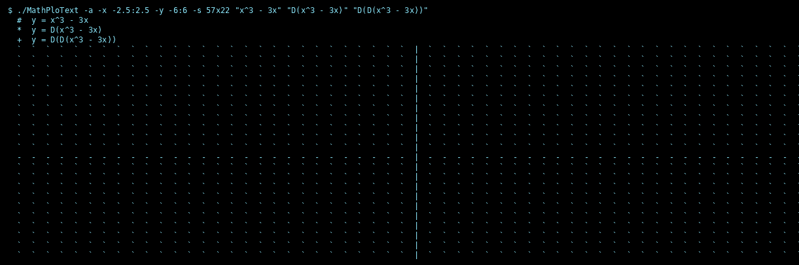<br>
<b>A cubic and its derivatives</b>: <code>x^3 - 3x</code>, <code>D(...)</code> and <code>D(D(...))</code><br>
<sub><code>./MathPloText -a -x -2.5:2.5 -y -6:6 -s 57x22 "x^3 - 3x" "D(x^3 - 3x)" "D(D(x^3 - 3x))"</code></sub>
</td>
<td width="50%" valign="top">
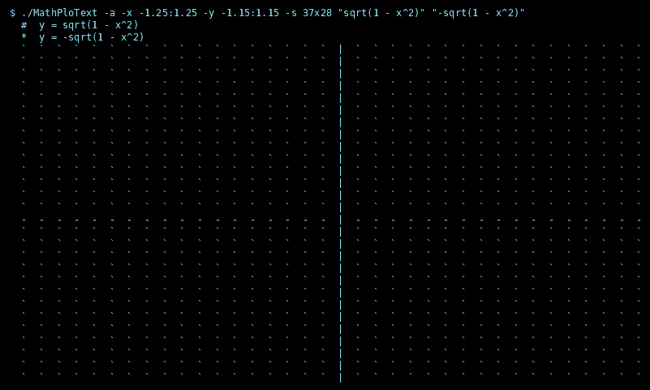<br>
<b>Circle</b>: two halves, <code>sqrt(1 - x^2)</code><br>
<sub><code>./MathPloText -a -x -1.25:1.25 -y -1.15:1.15 -s 37x28 "sqrt(1 - x^2)" "-sqrt(1 - x^2)"</code></sub>
</td>
</tr>
<tr>
<td width="50%" valign="top">
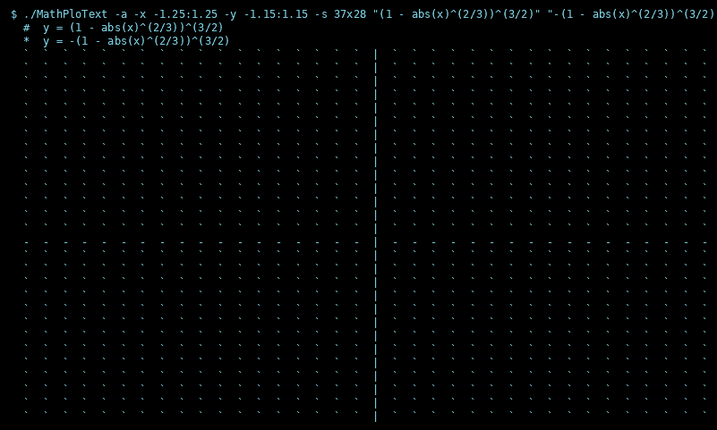<br>
<b>Astroid</b>: <code>(1 - abs(x)^(2/3))^(3/2)</code><br>
<sub><code>./MathPloText -a -x -1.25:1.25 -y -1.15:1.15 -s 37x28 "(1 - abs(x)^(2/3))^(3/2)" "-(1 - abs(x)^(2/3))^(3/2)"</code></sub>
</td>
<td width="50%" valign="top">
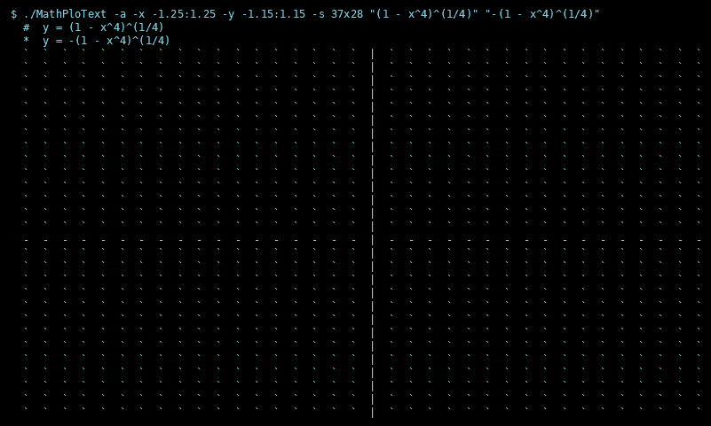<br>
<b>Squircle</b>: <code>(1 - x^4)^(1/4)</code><br>
<sub><code>./MathPloText -a -x -1.25:1.25 -y -1.15:1.15 -s 37x28 "(1 - x^4)^(1/4)" "-(1 - x^4)^(1/4)"</code></sub>
</td>
</tr>
<tr>
<td width="50%" valign="top">
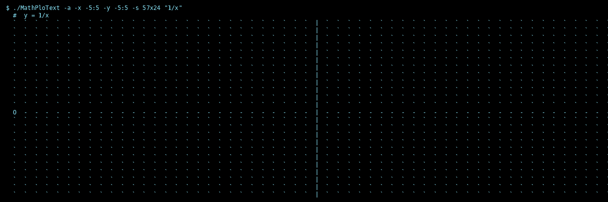<br>
<b>Hyperbola</b>: <code>1/x</code><br>
<sub><code>./MathPloText -a -x -5:5 -y -5:5 -s 57x24 "1/x"</code></sub>
</td>
<td width="50%" valign="top">
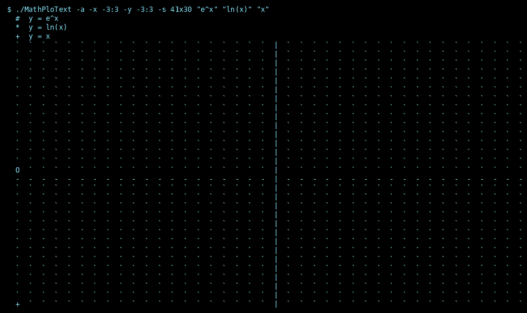<br>
<b>Inverse functions</b>: <code>e^x</code> and <code>ln(x)</code>, mirrors across <code>y = x</code><br>
<sub><code>./MathPloText -a -x -3:3 -y -3:3 -s 41x30 "e^x" "ln(x)" "x"</code></sub>
</td>
</tr>
<tr>
<td width="50%" valign="top">
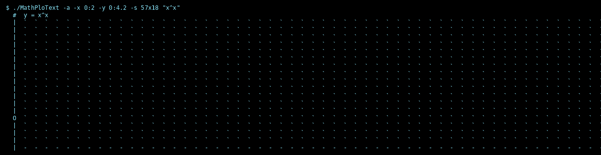<br>
<b>x^x</b>: lowest at <code>1/e</code><br>
<sub><code>./MathPloText -a -x 0:2 -y 0:4.2 -s 57x18 "x^x"</code></sub>
</td>
<td width="50%" valign="top">
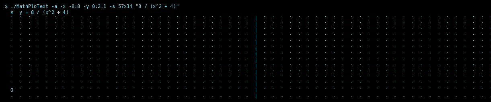<br>
<b>Witch of Agnesi</b>: <code>8 / (x^2 + 4)</code><br>
<sub><code>./MathPloText -a -x -8:8 -y 0:2.1 -s 57x14 "8 / (x^2 + 4)"</code></sub>
</td>
</tr>
<tr>
<td width="50%" valign="top">
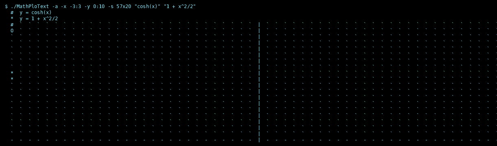<br>
<b>Catenary</b>: a hanging chain, <code>cosh(x)</code>, against the parabola <code>1 + x^2/2</code><br>
<sub><code>./MathPloText -a -x -3:3 -y 0:10 -s 57x20 "cosh(x)" "1 + x^2/2"</code></sub>
</td>
<td width="50%" valign="top">
<br>
<b>Staircase</b>: <code>floor(x)</code> and the fractional part <code>x - floor(x)</code><br>
<sub><code>./MathPloText -a -x -4:4 -y -4.2:4.2 -s 57x20 "floor(x)" "x - floor(x)"</code></sub>
</td>
</tr>
<tr>
<td width="50%" valign="top">
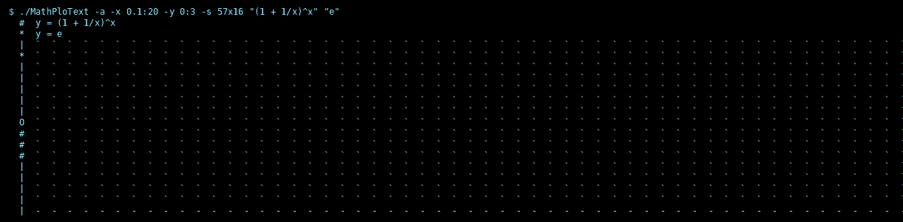<br>
<b>The number e</b>: <code>(1 + 1/x)^x</code> creeping up to <code>e</code><br>
<sub><code>./MathPloText -a -x 0.1:20 -y 0:3 -s 57x16 "(1 + 1/x)^x" "e"</code></sub>
</td>
<td width="50%" valign="top">
<br>
<b>Heart</b>: <code>x^(2/3) + 0.9 sqrt(3.3 - x^2) sin(10 pi x)</code><br>
<sub><code>./MathPloText -a -x -1.85:1.85 -y -1.5:2.6 -s 37x30 "heart(x)"</code></sub>
</td>
</tr>
<tr>
<td width="50%" valign="top">
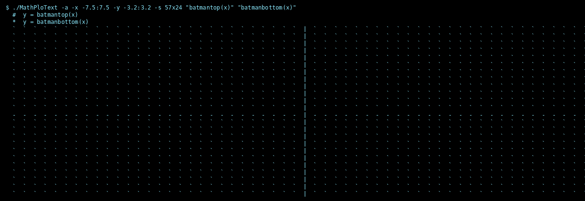<br>
<b>Batman</b>: the Batman logo in two functions<br>
<sub><code>./MathPloText -a -x -7.5:7.5 -y -3.2:3.2 -s 57x24 "batmantop(x)" "batmanbottom(x)"</code></sub>
</td>
</tr>
</table>

### Waves and signals

<table>
<tr>
<td width="50%" valign="top">
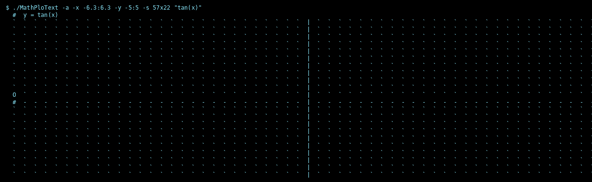<br>
<b>Tangent</b>: <code>tan(x)</code><br>
<sub><code>./MathPloText -a -x -6.3:6.3 -y -5:5 -s 57x22 "tan(x)"</code></sub>
</td>
<td width="50%" valign="top">
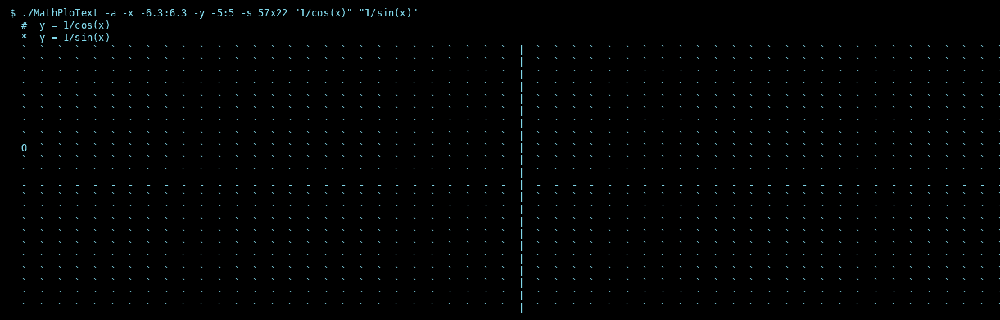<br>
<b>Secant and cosecant</b>: <code>1/cos(x)</code> and <code>1/sin(x)</code><br>
<sub><code>./MathPloText -a -x -6.3:6.3 -y -5:5 -s 57x22 "1/cos(x)" "1/sin(x)"</code></sub>
</td>
</tr>
<tr>
<td width="50%" valign="top">
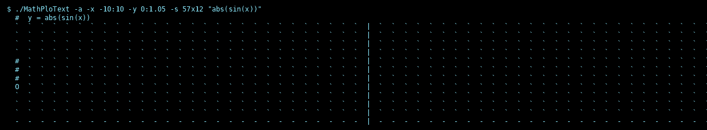<br>
<b>Rectified sine</b>: <code>abs(sin(x))</code><br>
<sub><code>./MathPloText -a -x -10:10 -y 0:1.05 -s 57x12 "abs(sin(x))"</code></sub>
</td>
<td width="50%" valign="top">
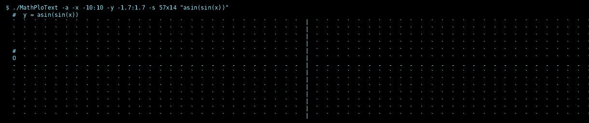<br>
<b>Triangle wave</b>: <code>asin(sin(x))</code><br>
<sub><code>./MathPloText -a -x -10:10 -y -1.7:1.7 -s 57x14 "asin(sin(x))"</code></sub>
</td>
</tr>
<tr>
<td width="50%" valign="top">
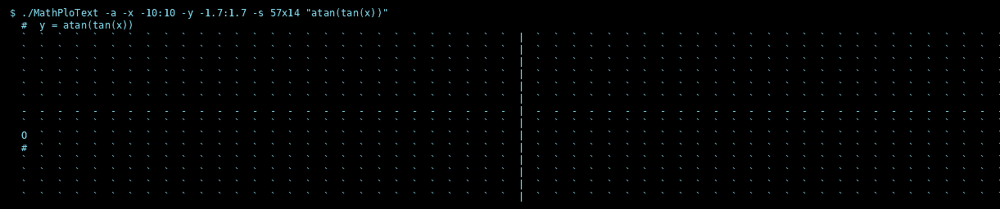<br>
<b>Sawtooth wave</b>: <code>atan(tan(x))</code><br>
<sub><code>./MathPloText -a -x -10:10 -y -1.7:1.7 -s 57x14 "atan(tan(x))"</code></sub>
</td>
<td width="50%" valign="top">
<br>
<b>Square wave</b>: its first 8 Fourier terms<br>
<sub><code>./MathPloText -a -x -6.3:6.3 -y -1.4:1.4 -s 57x16 "square(x)"</code></sub>
</td>
</tr>
<tr>
<td width="50%" valign="top">
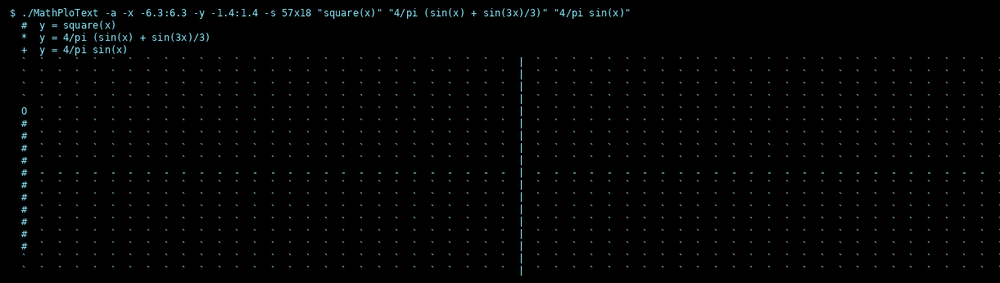<br>
<b>Fourier series</b>: the square wave with 1, 2 and 8 terms<br>
<sub><code>./MathPloText -a -x -6.3:6.3 -y -1.4:1.4 -s 57x18 "square(x)" "4/pi (sin(x) + sin(3x)/3)" "4/pi sin(x)"</code></sub>
</td>
<td width="50%" valign="top">
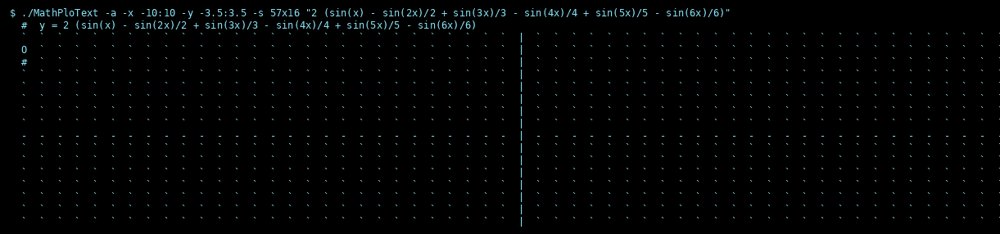<br>
<b>Sawtooth by Fourier</b>: <code>2 (sin(x) - sin(2x)/2 + sin(3x)/3 - ...)</code><br>
<sub><code>./MathPloText -a -x -10:10 -y -3.5:3.5 -s 57x16 "2 (sin(x) - sin(2x)/2 + sin(3x)/3 - sin(4x)/4 + sin(5x)/5 - sin(6x)/6)"</code></sub>
</td>
</tr>
<tr>
<td width="50%" valign="top">
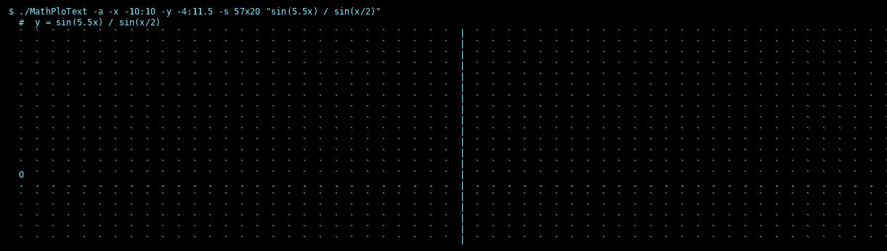<br>
<b>Dirichlet kernel</b>: <code>sin(5.5x) / sin(x/2)</code><br>
<sub><code>./MathPloText -a -x -10:10 -y -4:11.5 -s 57x20 "sin(5.5x) / sin(x/2)"</code></sub>
</td>
<td width="50%" valign="top">
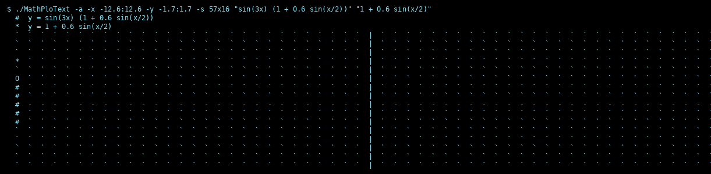<br>
<b>AM radio</b>: <code>sin(3x) (1 + 0.6 sin(x/2))</code><br>
<sub><code>./MathPloText -a -x -12.6:12.6 -y -1.7:1.7 -s 57x16 "sin(3x) (1 + 0.6 sin(x/2))" "1 + 0.6 sin(x/2)"</code></sub>
</td>
</tr>
<tr>
<td width="50%" valign="top">
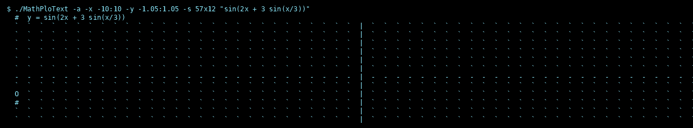<br>
<b>FM radio</b>: <code>sin(2x + 3 sin(x/3))</code><br>
<sub><code>./MathPloText -a -x -10:10 -y -1.05:1.05 -s 57x12 "sin(2x + 3 sin(x/3))"</code></sub>
</td>
<td width="50%" valign="top">
<br>
<b>Chirp</b>: <code>sin(x^2)</code><br>
<sub><code>./MathPloText -a -x 0:6 -y -1.1:1.1 -s 57x14 "sin(x^2)"</code></sub>
</td>
</tr>
<tr>
<td width="50%" valign="top">
<br>
<b>Beats</b>: <code>sin(6x) sin(x/2)</code><br>
<sub><code>./MathPloText -a -x -6.3:6.3 -y -1.1:1.1 -s 57x16 "sin(6x) sin(x/2)"</code></sub>
</td>
<td width="50%" valign="top">
<br>
<b>Damped oscillation</b>: <code>e^(-x/4) sin(4x)</code><br>
<sub><code>./MathPloText -a -x 0:12 -y -1:1 -s 57x18 "e^(-x/4) sin(4x)"</code></sub>
</td>
</tr>
<tr>
<td width="50%" valign="top">
<br>
<b>x sin(1/x)</b>: squeezed to zero<br>
<sub><code>./MathPloText -a -x -0.6:0.6 -y -0.15:0.6 -s 57x18 "x sin(1/x)"</code></sub>
</td>
<td width="50%" valign="top">
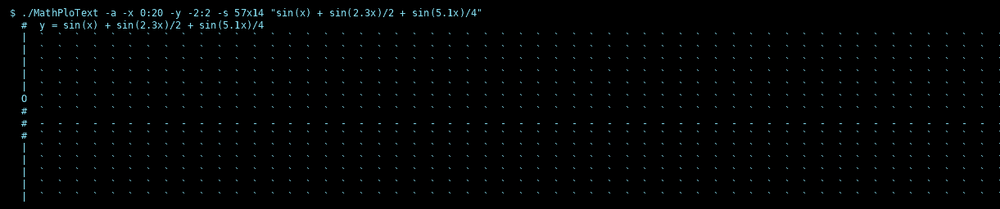<br>
<b>Waves at sea</b>: <code>sin(x) + sin(2.3x)/2 + sin(5.1x)/4</code><br>
<sub><code>./MathPloText -a -x 0:20 -y -2:2 -s 57x14 "sin(x) + sin(2.3x)/2 + sin(5.1x)/4"</code></sub>
</td>
</tr>
<tr>
<td width="50%" valign="top">
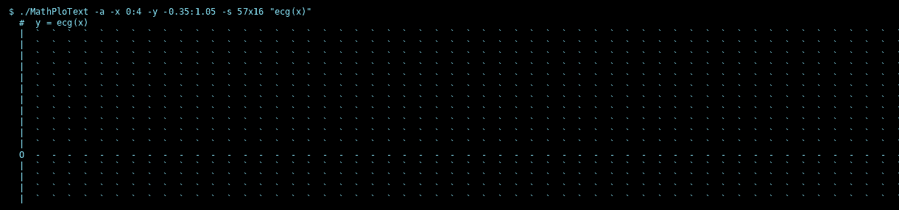<br>
<b>Heartbeat</b>: an electrocardiogram: P wave, QRS spike, T wave<br>
<sub><code>./MathPloText -a -x 0:4 -y -0.35:1.05 -s 57x16 "ecg(x)"</code></sub>
</td>
</tr>
</table>

### Calculus

<table>
<tr>
<td width="50%" valign="top">
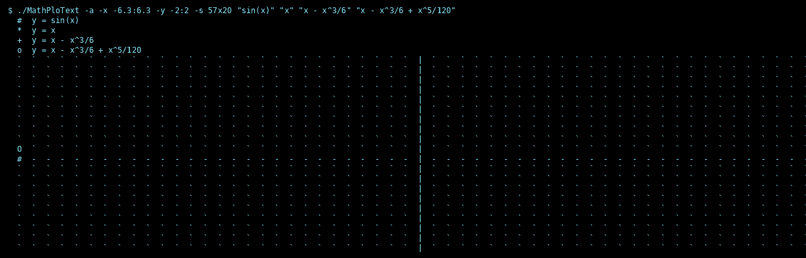<br>
<b>Taylor series of sin</b>: <code>x</code>, <code>x - x^3/6</code> and <code>x - x^3/6 + x^5/120</code> hugging <code>sin(x)</code><br>
<sub><code>./MathPloText -a -x -6.3:6.3 -y -2:2 -s 57x20 "sin(x)" "x" "x - x^3/6" "x - x^3/6 + x^5/120"</code></sub>
</td>
<td width="50%" valign="top">
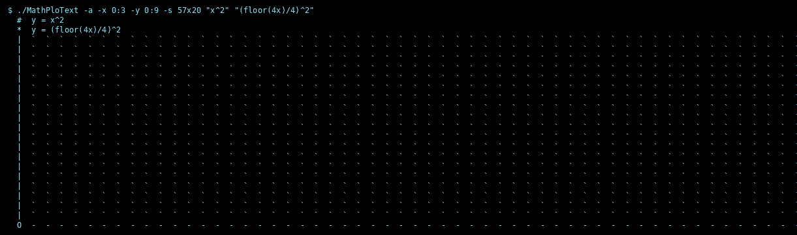<br>
<b>Riemann sum</b>: steps under <code>x^2</code><br>
<sub><code>./MathPloText -a -x 0:3 -y 0:9 -s 57x20 "x^2" "(floor(4x)/4)^2"</code></sub>
</td>
</tr>
<tr>
<td width="50%" valign="top">
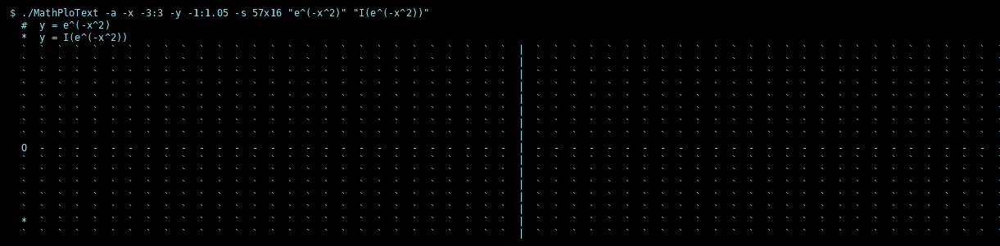<br>
<b>Gaussian and its integral</b>: <code>e^(-x^2)</code> and <code>I(e^(-x^2))</code><br>
<sub><code>./MathPloText -a -x -3:3 -y -1:1.05 -s 57x16 "e^(-x^2)" "I(e^(-x^2))"</code></sub>
</td>
<td width="50%" valign="top">
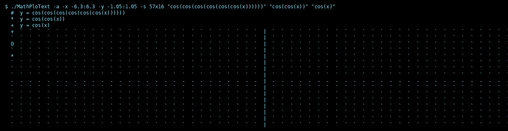<br>
<b>Dottie number</b>: <code>cos(cos(cos(...)))</code> flattening to 0.739<br>
<sub><code>./MathPloText -a -x -6.3:6.3 -y -1.05:1.05 -s 57x16 "cos(cos(cos(cos(cos(cos(x))))))" "cos(cos(x))" "cos(x)"</code></sub>
</td>
</tr>
</table>

### Special functions

<table>
<tr>
<td width="50%" valign="top">
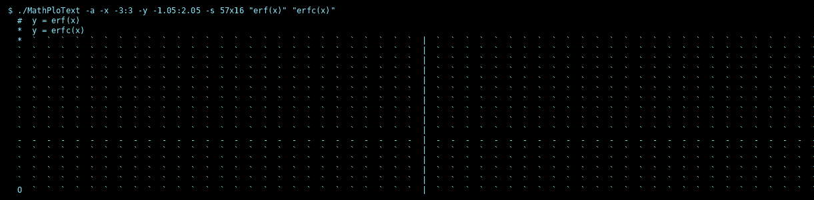<br>
<b>Error function</b>: <code>erf(x)</code> and <code>erfc(x)</code><br>
<sub><code>./MathPloText -a -x -3:3 -y -1.05:2.05 -s 57x16 "erf(x)" "erfc(x)"</code></sub>
</td>
<td width="50%" valign="top">
<br>
<b>Gamma</b>: the factorial for any x, <code>gamma(n) = (n-1)!</code><br>
<sub><code>./MathPloText -a -x -4.5:4.5 -y -6:6 -s 57x22 "gamma(x)"</code></sub>
</td>
</tr>
<tr>
<td width="50%" valign="top">
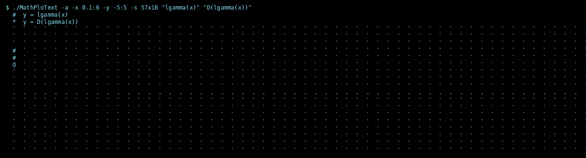<br>
<b>Log gamma and digamma</b>: <code>lgamma(x)</code> and its derivative<br>
<sub><code>./MathPloText -a -x 0.1:6 -y -5:5 -s 57x18 "lgamma(x)" "D(lgamma(x))"</code></sub>
</td>
<td width="50%" valign="top">
<br>
<b>Bessel functions</b>: <code>J0</code>, <code>J1</code> and <code>J2</code>, the vibrations of a drum head<br>
<sub><code>./MathPloText -a -x 0:20 -y -0.45:1.05 -s 57x16 "bessel(x)" "bessel1(x)" "besseln(2, x)"</code></sub>
</td>
</tr>
<tr>
<td width="50%" valign="top">
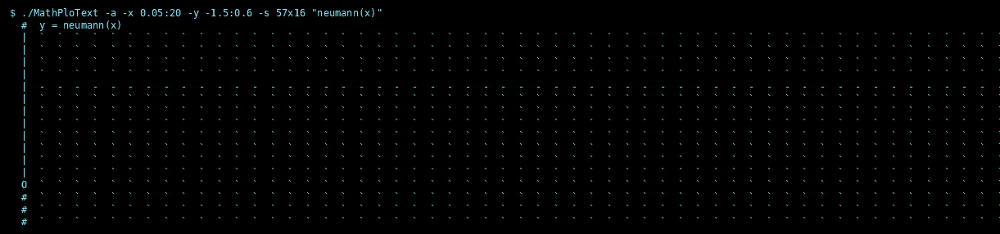<br>
<b>Neumann function</b>: <code>Y0</code>, the Bessel of the second kind<br>
<sub><code>./MathPloText -a -x 0.05:20 -y -1.5:0.6 -s 57x16 "neumann(x)"</code></sub>
</td>
<td width="50%" valign="top">
<br>
<b>Sinc</b>: <code>sin(x) / x</code><br>
<sub><code>./MathPloText -a -x -20:20 -y -0.3:1.05 -s 57x16 "sinc(x)"</code></sub>
</td>
</tr>
<tr>
<td width="50%" valign="top">
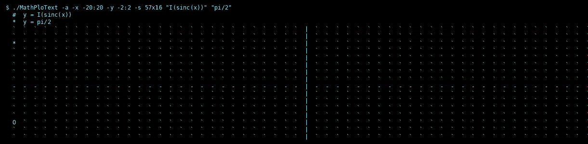<br>
<b>Sine integral</b>: <code>I(sinc(x))</code> oscillating around pi/2<br>
<sub><code>./MathPloText -a -x -20:20 -y -2:2 -s 57x16 "I(sinc(x))" "pi/2"</code></sub>
</td>
<td width="50%" valign="top">
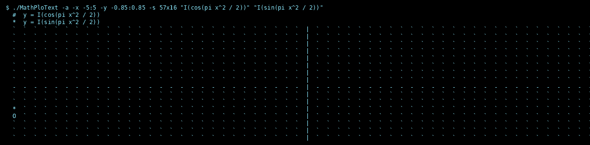<br>
<b>Fresnel integrals</b>: <code>C(x)</code> and <code>S(x)</code>, the two halves of the Euler spiral<br>
<sub><code>./MathPloText -a -x -5:5 -y -0.85:0.85 -s 57x16 "I(cos(pi x^2 / 2))" "I(sin(pi x^2 / 2))"</code></sub>
</td>
</tr>
<tr>
<td width="50%" valign="top">
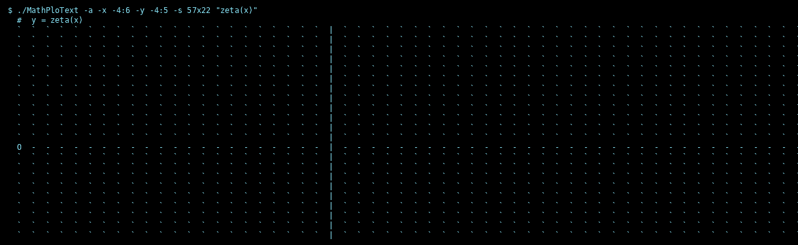<br>
<b>Riemann zeta</b>: <code>zeta(2) = pi^2/6</code>, a pole at 1<br>
<sub><code>./MathPloText -a -x -4:6 -y -4:5 -s 57x22 "zeta(x)"</code></sub>
</td>
<td width="50%" valign="top">
<br>
<b>Lambert W</b>: the <code>w</code> with <code>w e^w = x</code><br>
<sub><code>./MathPloText -a -x -0.4:6 -y -1.1:1.6 -s 57x16 "lambertw(x)"</code></sub>
</td>
</tr>
<tr>
<td width="50%" valign="top">
<br>
<b>Legendre polynomials</b>: <code>P1</code> to <code>P5</code><br>
<sub><code>./MathPloText -a -x -1:1 -y -1.05:1.05 -s 57x20 "legendre(1, x)" "legendre(2, x)" "legendre(3, x)" "legendre(4, x)" "legendre(5, x)"</code></sub>
</td>
<td width="50%" valign="top">
<br>
<b>Chebyshev polynomials</b>: <code>cos(n acos(x))</code><br>
<sub><code>./MathPloText -a -x -1:1 -y -1.05:1.05 -s 57x20 "cos(2 acos(x))" "cos(3 acos(x))" "cos(5 acos(x))"</code></sub>
</td>
</tr>
</table>

### Physics

<table>
<tr>
<td width="50%" valign="top">
<br>
<b>Quantum harmonic oscillator</b>: the first four states sitting on their energy levels<br>
<sub><code>./MathPloText -a -x -4.5:4.5 -y 0:4.6 -s 57x26 "oscillator(0, x) + 0.5" "oscillator(1, x) + 1.5" "oscillator(2, x) + 2.5" "oscillator(3, x) + 3.5" "x^2/2"</code></sub>
</td>
<td width="50%" valign="top">
<br>
<b>Hydrogen atom</b>: how far the electron is, in the 1s, 2s and 2p states<br>
<sub><code>./MathPloText -a -x 0:16 -y 0:0.6 -s 57x16 "4 x^2 e^(-2x)" "x^2 (2 - x)^2 e^(-x) / 8" "x^4 e^(-x) / 24"</code></sub>
</td>
</tr>
<tr>
<td width="50%" valign="top">
<br>
<b>Particle in a box</b>: the first three states<br>
<sub><code>./MathPloText -a -x 0:1 -y 0:3.5 -s 57x22 "sin(pi x)^2" "sin(2 pi x)^2 + 1.2" "sin(3 pi x)^2 + 2.4"</code></sub>
</td>
<td width="50%" valign="top">
<br>
<b>Pendulum period</b>: how much longer a swing of x radians takes<br>
<sub><code>./MathPloText -a -x 0:3.1 -y 0:4 -s 57x16 "pendulum(x)"</code></sub>
</td>
</tr>
<tr>
<td width="50%" valign="top">
<br>
<b>Projectile</b>: thrown at 30, 45 and 60 degrees<br>
<sub><code>./MathPloText -a -x 0:10.5 -y 0:4 -s 57x16 "x tan(pi/4) - 9.8 x^2 / (200 cos(pi/4)^2)" "x tan(pi/3) - 9.8 x^2 / (200 cos(pi/3)^2)" "x tan(pi/6) - 9.8 x^2 / (200 cos(pi/6)^2)"</code></sub>
</td>
<td width="50%" valign="top">
<br>
<b>Planck's law</b>: black body light at three temperatures<br>
<sub><code>./MathPloText -a -x 0:12 -y 0:6 -s 57x16 "x^3 / (e^(x/1.6) - 1)" "x^3 / (e^(x/1.3) - 1)" "x^3 / (e^x - 1)"</code></sub>
</td>
</tr>
<tr>
<td width="50%" valign="top">
<br>
<b>Maxwell-Boltzmann</b>: speeds of gas molecules, cold to hot<br>
<sub><code>./MathPloText -a -x 0:5 -y 0:1.2 -s 57x16 "4/sqrt(pi) x^2 e^(-x^2)" "4/sqrt(pi) x^2 e^(-x^2/2) / 2^1.5" "4/sqrt(pi) x^2 e^(-x^2/4) / 8"</code></sub>
</td>
<td width="50%" valign="top">
<br>
<b>Lennard-Jones</b>: the pull and push between two atoms<br>
<sub><code>./MathPloText -a -x 0.9:3 -y -1.2:1.5 -s 57x16 "4 (x^-12 - x^-6)"</code></sub>
</td>
</tr>
<tr>
<td width="50%" valign="top">
<br>
<b>Morse potential</b>: a chemical bond<br>
<sub><code>./MathPloText -a -x 0:6 -y -1.1:2 -s 57x16 "(1 - e^(-(x - 1)))^2 - 1"</code></sub>
</td>
<td width="50%" valign="top">
<br>
<b>Resonance</b>: a swing pushed at x times its own frequency, three dampings<br>
<sub><code>./MathPloText -a -x 0:2.5 -y 0:6 -s 57x18 "1 / sqrt((1 - x^2)^2 + (0.2x)^2)" "1 / sqrt((1 - x^2)^2 + (0.5x)^2)" "1 / sqrt((1 - x^2)^2 + (1.2x)^2)"</code></sub>
</td>
</tr>
<tr>
<td width="50%" valign="top">
<br>
<b>RC circuit</b>: a capacitor charging and discharging<br>
<sub><code>./MathPloText -a -x 0:6 -y 0:1.05 -s 57x14 "1 - e^(-x)" "e^(-x)"</code></sub>
</td>
<td width="50%" valign="top">
<br>
<b>Fermi-Dirac</b>: electrons filling levels, cold to hot<br>
<sub><code>./MathPloText -a -x 0:10 -y 0:1.05 -s 57x14 "1 / (e^((x - 5)/0.1) + 1)" "1 / (e^((x - 5)/0.5) + 1)" "1 / (e^((x - 5)/1.2) + 1)"</code></sub>
</td>
</tr>
<tr>
<td width="50%" valign="top">
<br>
<b>Single and double slit</b>: light through one slit and through two<br>
<sub><code>./MathPloText -a -x -10:10 -y 0:1.05 -s 57x16 "cos(3x)^2 sinc(x)^2" "sinc(x)^2"</code></sub>
</td>
<td width="50%" valign="top">
<br>
<b>Neural network activations</b>: sigmoid, tanh, ReLU, softplus and GELU<br>
<sub><code>./MathPloText -a -x -4:4 -y -1.2:3 -s 57x20 "1 / (1 + e^(-x))" "tanh(x)" "max(0, x)" "ln(1 + e^x)" "x (1 + erf(x / sqrt(2))) / 2"</code></sub>
</td>
</tr>
</table>

### Probability

<table>
<tr>
<td width="50%" valign="top">
<br>
<b>Normal distribution</b>: three widths<br>
<sub><code>./MathPloText -a -x -6:6 -y 0:0.85 -s 57x16 "e^(-x^2/0.5) / (0.5 sqrt(2 pi))" "e^(-x^2/2) / sqrt(2 pi)" "e^(-x^2/8) / (2 sqrt(2 pi))"</code></sub>
</td>
<td width="50%" valign="top">
<br>
<b>Cauchy against normal</b>: heavy tails<br>
<sub><code>./MathPloText -a -x -6:6 -y 0:0.45 -s 57x14 "1 / (pi (1 + x^2))" "e^(-x^2/2) / sqrt(2 pi)"</code></sub>
</td>
</tr>
<tr>
<td width="50%" valign="top">
<br>
<b>Poisson distribution</b>: events per hour, 4 on average<br>
<sub><code>./MathPloText -a -x 0:14 -y 0:0.22 -s 57x14 "e^(-4) 4^floor(x) / gamma(floor(x) + 1)"</code></sub>
</td>
<td width="50%" valign="top">
<br>
<b>Gamma distribution</b>: waiting for 1, 2 and 5 events<br>
<sub><code>./MathPloText -a -x 0:12 -y 0:1.05 -s 57x16 "x^0 e^(-x)" "x e^(-x)" "x^4 e^(-x) / 24"</code></sub>
</td>
</tr>
<tr>
<td width="50%" valign="top">
<br>
<b>Beta distribution</b>: three shapes<br>
<sub><code>./MathPloText -a -x 0:1 -y 0:2.6 -s 57x16 "30 x (1 - x)^4" "30 x^4 (1 - x)" "6 x (1 - x)"</code></sub>
</td>
</tr>
</table>

### Number theory

<table>
<tr>
<td width="50%" valign="top">
<br>
<b>Prime counting</b>: <code>pi(x)</code>, the primes up to x, against <code>x / ln(x)</code><br>
<sub><code>./MathPloText -a -x 2:100 -y 0:26 -s 57x18 "primecount(x)" "x / ln(x)"</code></sub>
</td>
<td width="50%" valign="top">
<br>
<b>Euler's totient</b>: how many numbers up to n share no factor with n<br>
<sub><code>./MathPloText -a -x 1:120 -y 0:120 -s 57x20 "totient(x)"</code></sub>
</td>
</tr>
<tr>
<td width="50%" valign="top">
<br>
<b>Divisors</b>: how many divisors n has<br>
<sub><code>./MathPloText -a -x 1:120 -y 0:16.5 -s 57x18 "divisors(x)"</code></sub>
</td>
<td width="50%" valign="top">
<br>
<b>Collatz</b>: steps from n down to 1<br>
<sub><code>./MathPloText -a -x 1:120 -y 0:120 -s 57x20 "collatz(x)"</code></sub>
</td>
</tr>
<tr>
<td width="50%" valign="top">
<br>
<b>Mobius and Mertens</b>: <code>mu(n)</code> and its running sum<br>
<sub><code>./MathPloText -a -x 1:120 -y -4.2:2.2 -s 57x16 "mobius(x)" "mertens(x)"</code></sub>
</td>
<td width="50%" valign="top">
<br>
<b>Digit sum</b>: the sum of the digits of n<br>
<sub><code>./MathPloText -a -x 0:200 -y 0:19 -s 57x16 "digitsum(x)"</code></sub>
</td>
</tr>
</table>

### Chaos

<table>
<tr>
<td width="50%" valign="top">
<br>
<b>Logistic map</b>: <code>x -&gt; r x (1 - x)</code>: order, period doubling, chaos<br>
<sub><code>./MathPloText -a -x 2.8:4 -y 0:1 -s 57x24 "logistic(x)"</code></sub>
</td>
<td width="50%" valign="top">
<br>
<b>Lyapunov exponent</b>: below zero order, above zero chaos<br>
<sub><code>./MathPloText -a -x 2.8:4 -y -1.5:0.8 -s 57x18 "lyapunov(x)"</code></sub>
</td>
</tr>
<tr>
<td width="50%" valign="top">
<br>
<b>Sine map</b>: <code>x -&gt; r sin(pi x)</code>, the same road to chaos<br>
<sub><code>./MathPloText -a -x 0.6:1 -y 0:1 -s 57x24 "sinemap(x)"</code></sub>
</td>
<td width="50%" valign="top">
<br>
<b>Mandelbrot set</b>: <code>z -&gt; z^2 + c</code> on the real line<br>
<sub><code>./MathPloText -a -x -2:0.3 -y -2:2 -s 57x24 "mandelbrot(x)"</code></sub>
</td>
</tr>
</table>

### Fractals and noise

<table>
<tr>
<td width="50%" valign="top">
<br>
<b>Weierstrass</b>: continuous everywhere, smooth nowhere<br>
<sub><code>./MathPloText -a -x -2:2 -y -2.1:2.1 -s 57x22 "weierstrass(x)"</code></sub>
</td>
<td width="50%" valign="top">
<br>
<b>Riemann</b>: <code>sum of sin(n^2 x) / n^2</code><br>
<sub><code>./MathPloText -a -x -6.3:6.3 -y -1.1:1.7 -s 57x20 "riemann(x)"</code></sub>
</td>
</tr>
<tr>
<td width="50%" valign="top">
<br>
<b>Cantor, the devil's staircase</b>: flat almost everywhere, still climbs from 0 to 1<br>
<sub><code>./MathPloText -a -x 0:1 -y 0:1.05 -s 57x20 "cantor(x)"</code></sub>
</td>
<td width="50%" valign="top">
<br>
<b>Takagi-Landsberg</b>: the Blancmange with weights 0.3, 0.5 and 0.7<br>
<sub><code>./MathPloText -a -x 0:1 -y 0:1.4 -s 57x20 "takagi(0.7, x)" "takagi(0.5, x)" "takagi(0.3, x)"</code></sub>
</td>
</tr>
<tr>
<td width="50%" valign="top">
<br>
<b>Minkowski question mark</b>: continued fractions turned into binary<br>
<sub><code>./MathPloText -a -x 0:1 -y 0:1.05 -s 57x20 "minkowski(x)" "x"</code></sub>
</td>
<td width="50%" valign="top">
<br>
<b>Smooth noise</b>: random heights, smoothly joined<br>
<sub><code>./MathPloText -a -x 0:20 -y 0:1.05 -s 57x12 "noise(x)"</code></sub>
</td>
</tr>
<tr>
<td width="50%" valign="top">
<br>
<b>Terrain</b>: noise on noise: mountains<br>
<sub><code>./MathPloText -a -x 0:20 -y 0:2 -s 57x14 "terrain(x)"</code></sub>
</td>
<td width="50%" valign="top">
<br>
<b>Skyline</b>: one building per unit, random heights<br>
<sub><code>./MathPloText -a -x 0:30 -y 0:9 -s 57x14 "skyline(x)"</code></sub>
</td>
</tr>
</table>

<!-- /gallery -->

## C++

```cpp
#include "MathPloText.hpp"
#include "MathPloTextFluid.hpp"

MathPloText *math = new MathPloText();

math->SetConfig();
math->SetMatrix();
math->AnimateGraph(Pow, 2);

math->AddCurve(Matharium);
math->SetWindow(-20, 8, -11, 27);
math->AnimateCurves();

MathPloText *fluid = new MathPloText();

fluid->SetConfig();
fluid->AddWave(Burgers);
fluid->SetWindow(-3.2, 3.2, -1.2, 1.2);
fluid->AnimateTime(3);
```
